Read "[AI Usage](docs/md/ai_usage.md)" for information on how AI was used in this Projects Development!

# Strata

**A self-hosted, SCADA-inspired dashboard for running a Caddy file server behind a Cloudflare Tunnel.**  
Drives and access rules, live traffic, scraper-auto-bans, mail alerts, accounts and file management,  
all in plain python and HTML - No cloud, no AI upselling, no SaaS-DA-9000-Styling.

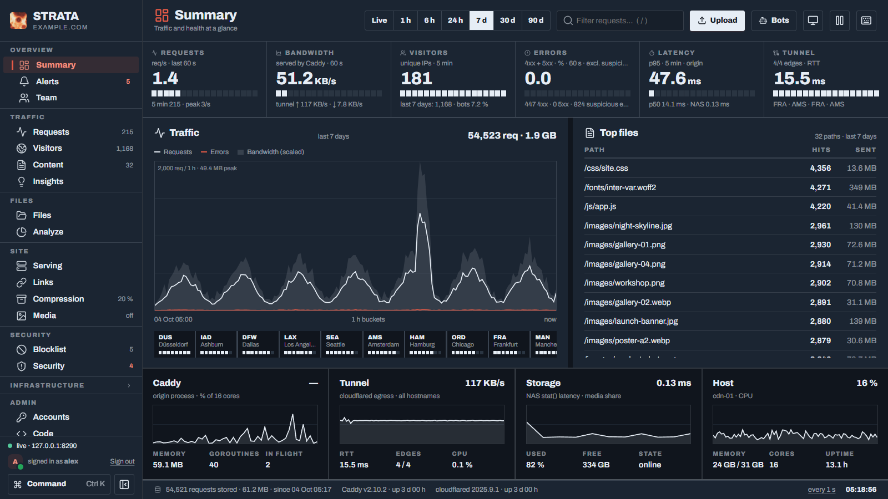

[Install](#install) · [How it works](#how-it-works) · [Configuration](#configuration) · [Development](#development) · [Security](SECURITY.md)

---

I serve files from a NAS through Caddy and a Cloudflare Tunnel. Managing that meant editing the Caddyfile and cloudflared config by hand and reading Caddy's JSON access log every time to see what was going on. Strata started as a way for me to automate / GUI-drive this process, and grew from there into a genuinely capable control interface that (usually) just works and doesn't look like "SaaS AI Dashboard iteration #73-2026-09-28".

It's designed to run on the same machine as [Caddy](https://caddyserver.com) and
[cloudflared](https://github.com/cloudflare/cloudflared). It reads Caddy's access log, writes and updates your caddy config file as you go, and can use the Cloudflare API for DNS, cache purges and blocking IPs at the edge. It's written in plain Python with no web framework, stores everything in SQLite, and the dashboard is vanilla JavaScript with no build step. 

Strata is tested and supported on both Windows and Linux. The installation steps below cover the platform-specific setup.

## What it does


### Serving files through Caddy

Strata manages Caddy configuration through the dashboard. A *drive* maps a local directory or proxied service to a hostname and optional URL prefix. Each drive can have its own access rules, including allow/block lists, password protection, signed URLs, cache headers, gallery views, download prompts and redirects. Rules can also be applied to individual paths.

The generated configuration lives in `generated/cdn.caddy`. Import it into your Caddyfile (the installer adds this line for you):

```caddyfile
import C:/Strata/generated/cdn.caddy
```

Every update is validated with `caddy validate` before Caddy reloads the configuration. If validation fails, the current configuration remains active. Previous versions are retained and can be restored from the dashboard.

Strata can also generate Brotli-compressed copies of files when compression reduces their size enough to be worthwhile. Caddy serves these copies to clients that support Brotli.

### Error pages, galleries and audio player

Since these are important features to me, Strata includes custom error pages, a directory gallery and an audio player. All three are HTML files that can easily be edited inside the dashboard without changing Strata's code.


| Feature          | Enable it                                                             | Template                                                             |
| ---------------- | --------------------------------------------------------------------- | -------------------------------------------------------------------- |
| **Error pages**  | Site › Serving › Site › Error pages                                   | Copied from `static/errors/` to your preferred drive for reliability |
| **Gallery**      | Add an access rule with the **Gallery view** action, e.g. `/photos/`* | `gallery/gallery.html` - include `/`* to list sub-folders too        |
| **Audio player** | Add an access rule with the **Audio player** action, e.g. `/music/`*  | `player/player.html` - include `/`* to list sub-folders too          |


#### Error pages


|                                                                                                      |                                                       |                                                         |
| ---------------------------------------------------------------------------------------------------- | ----------------------------------------------------- | ------------------------------------------------------- |
| 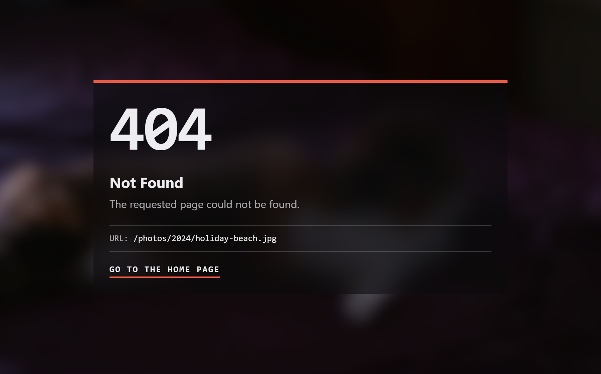 | 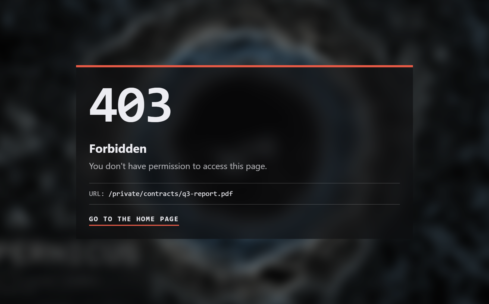 | 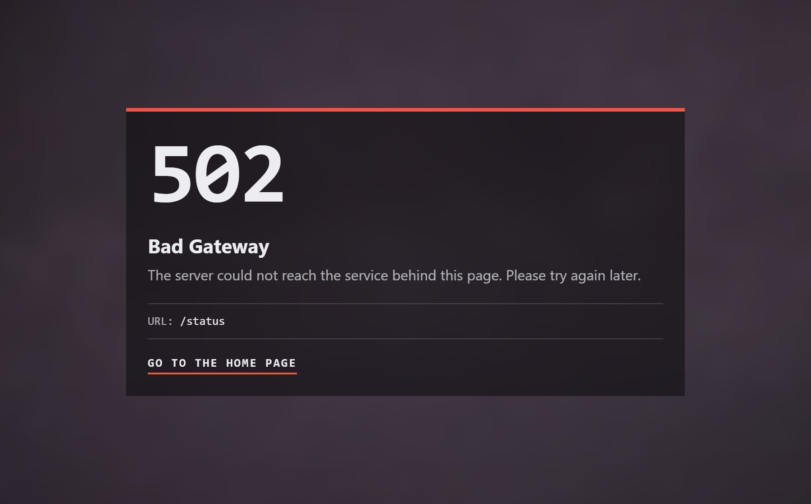 |


In `Site › Serving › Site`, click **Edit** next to a status code to edit its page. If the page doesn't exist on the selected drive, Strata copies it from `static/errors/` first. **Preview** opens the page in a new tab.

The pages cover 404 (missing or hidden files), 403 (blocked or trashed files) and 502/503/504 (unavailable proxied services). They support light and dark mode and use five CSS variables for their colour scheme: `--bg`, `--text`, `--dim`, `--line` and `--accent`. Error pages aren't cached. If the 502 page isn't configured, Caddy returns plain text.

Each page contains five small WebP background images embedded as data URIs. They're 40 × 24 pixels and roughly 250 bytes each. One is selected at random, scaled to the window and blurred. 

To change the default background colour palettes, edit `static/errors/backgrounds.py` and run the script. It regenerates the images embedded in all three error pages.

The pages can also display a background photo. Near the end of each HTML file, `var photos = [...]` contains 12 image URLs pointing to my CDN. Images are requested as WebP at up to 1920 pixels wide (`?w=1920&fm=webp`), with each source intended to stay under 500 KB. A random photo is selected; until it loads, the generated background remains visible. Once loaded, the photo replaces the standard colorway with itself and a lighter blur.

Replace the URLs with your own images or empty the list to use only the embedded backgrounds. This will soon be replaced by a simple json index file set through the Site-settings.


|                                                                                                                                                                                    |                                                                                                                                                                                 |
| ---------------------------------------------------------------------------------------------------------------------------------------------------------------------------------- | ------------------------------------------------------------------------------------------------------------------------------------------------------------------------------- |
| 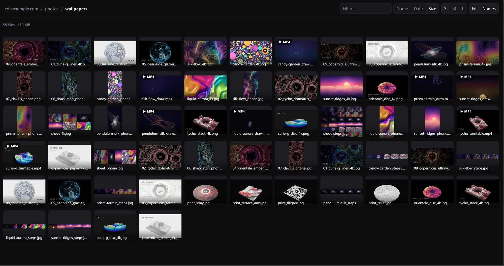 | 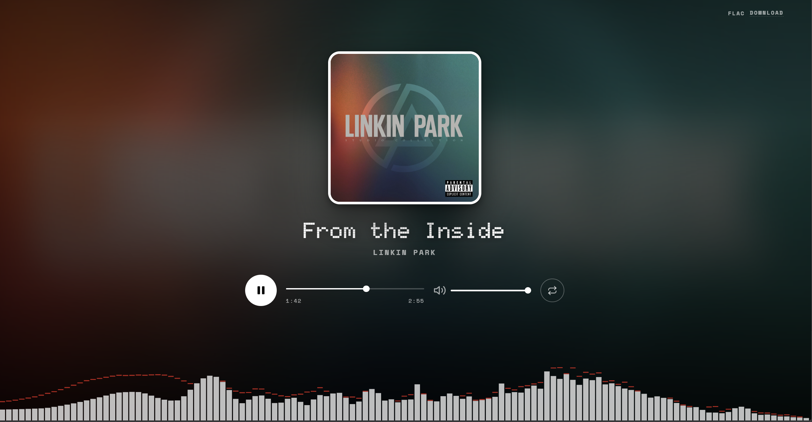 |


**Gallery**

- Displays directory contents as a thumbnail grid, with sorting, three tile sizes and a full-screen viewer.
- Thumbnails are requested with `?w=`; with Media on, Strata picks AVIF or WebP by what the browser accepts.
- A thumbnail that is still being encoded is retried, never replaced by the full-size original.
- Thumbnails are cached by Cloudflare; directory listings aren't cached.

**Audio player**

- Opens a full-page player with cover art, track title, artist and an audio visualizer.
- Looks for cover art alongside the track, using files such as `cover.jpg` or `folder.jpg`.
- If no cover art is found, uses a random image from the placeholder folder configured on the rule.
- Serves the original audio file to phones, HTML `<audio>` elements, link previews and requests containing `?dl=1` or `?raw=1`.


#### (Gallery and audio player configs)

Both pages are Caddy templates. Their HTML and CSS can be edited directly; changes take effect on the next request. CSS variables near the top of each file control the appearance. The gallery uses variables such as `--bg` and `--accent`, while the player uses `--ink`, `--red` and `--mono`.

### Link previews

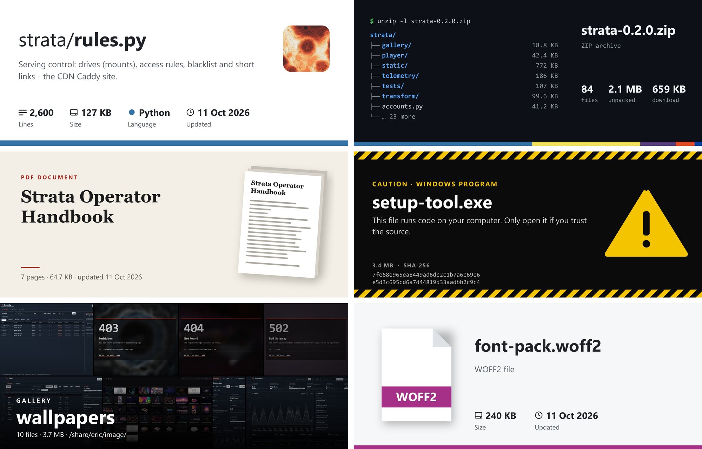

When someone shares a link to a file in Discord, Slack, Telegram, X, WhatsApp or similar apps, Strata answers the preview request with a card for that file: audio (cover and waveform), code and text (a repository-style card), archives (a terminal listing), PDFs (a document cover), gallery folders (their pictures), programs and scripts (a caution card with the SHA-256) and everything else (type, size and date). Pictures, videos and web pages keep the apps' own embeds.

Hidden, protected and held files never get a preview. The **embed** tab in the Files inspector shows the card and lets you set its title, description, colour, card type or image, or switch it off. Preview crawlers need **Zone › Cache Rules › Edit** on the Cloudflare API token, so they reach your server instead of a cached copy of the file.

### Traffic


|                                                                                                                                 |                                                                                                                                              |
| ------------------------------------------------------------------------------------------------------------------------------- | -------------------------------------------------------------------------------------------------------------------------------------------- |
| 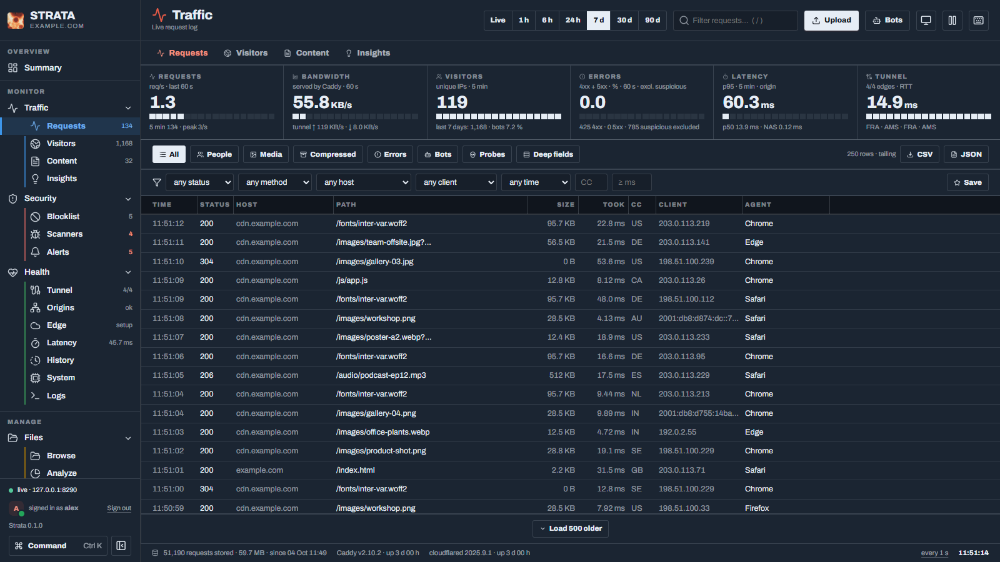 | 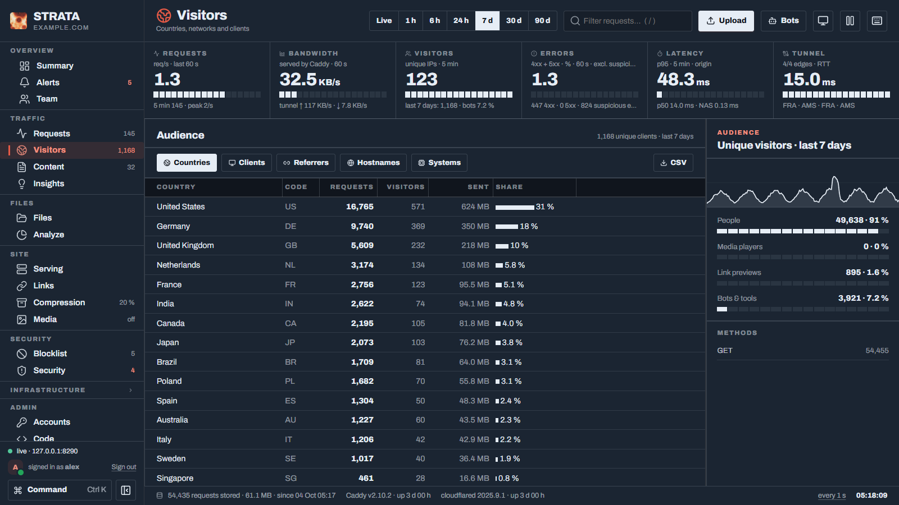 |


Strata reads Caddy's access log into SQLite. The dashboard includes a live request log with filters and saved views, visitor statistics by country, network and client, the most requested files, and latency percentiles.

Individual requests are retained for 30 days; per-minute, hourly and daily aggregates are retained for 400 days. Both retention periods are configurable. Visitor countries come from Cloudflare's `Cf-Ipcountry` header, so Strata doesn't need a GeoIP database.

### Security

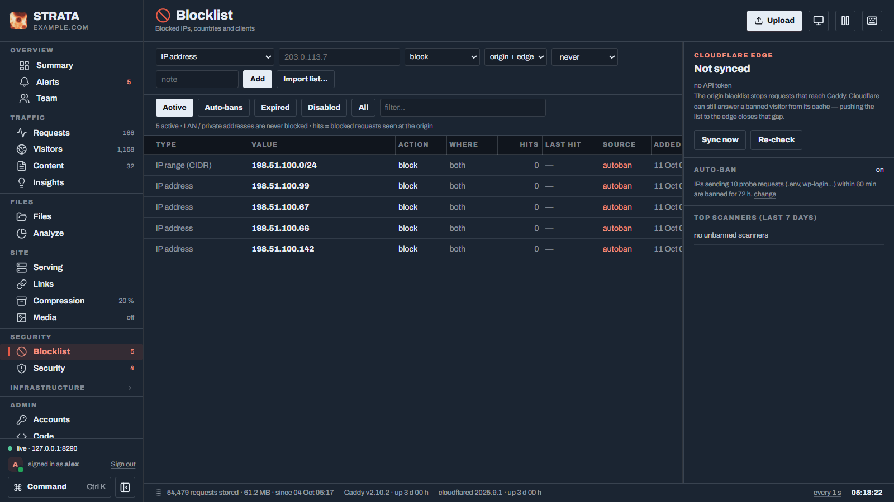

Strata tracks requests for common probe targets such as `/.env` and `/wp-login.php`. Addresses that exceed the configured thresholds are banned automatically. If several addresses within the same `/24` subnet are banned within a week, Strata bans the entire range. Repeat offenders receive longer bans.

With a Cloudflare API token configured, Strata also pushes its blocklist to Cloudflare. Requests from banned addresses can then be rejected at the edge before reaching your server.

Security and service alerts appear in the dashboard. These include bans, failed sign-ins, outages, low disk space and error spikes. Alerts can also be sent by e-mail through SMTP or Resend, or to webhooks such as Discord, Slack, ntfy and endpoints that accept JSON.

<br clear="right">

### Bot protection (optional)

[Anubis](https://anubis.techaro.lol) ([MIT](https://github.com/TecharoHQ/anubis), by Techaro) makes a browser solve a small proof-of-work puzzle before it gets a page, which slows scrapers down. Strata can put it in front of paths you choose. It is **off by default**: Strata doesn't bundle Anubis, nothing runs until the owner clicks, and with it off nothing changes, not even the generated Caddy config.

1. **Security › Challenger › Set up everything.** The dashboard downloads Anubis 1.28.1 (the version Strata is tested with) from github.com, creates the signing key and the policy, registers a start-up task (Task Scheduler on Windows, a systemd unit on Linux; [docs/anubis/strata-anubis.service](docs/anubis/strata-anubis.service) is the unit as a sample), starts it, and switches protection on once Anubis answers. Each of those is also a button of its own on the page: install, register, remove, check, restart, stop, and the on/off switch (Strata won't switch it on while Anubis doesn't answer, and won't stop it while it is on).
2. **Challenge all pages** on the same page adds the rule, or use **Serving › Rules** with the action **Bot challenge** for the paths you choose.

The download (about 25 MB) is fetched over HTTPS from github.com only, checked against the SHA-256 GitHub publishes for that file, and only `anubis(.exe)` and its licence are unpacked, into `.private/anubis/` of the instance. It doesn't check the release's PGP signature, and a compromised GitHub release would pass the checksum. To use an Anubis you installed yourself (a package, a pinned container's binary), put its path under **Challenger › Settings**.

Caddy asks Anubis through `forward_auth` (Anubis runs without a target, so it never proxies your files and nothing loops). A visitor with a valid pass cookie carries on; the others are redirected to Anubis' puzzle page, solve it in their browser's JavaScript, and land on the page they asked for. Anubis' puzzle page needs a public URL to know where to send the browser afterwards; Strata passes just the scheme (`https://`, as everything arrives through Cloudflare), so one Anubis serves every host name of the instance.

**Try it first.** `python tests/anubis_demo.py --caddy <caddy> --anubis <anubis>` starts a small site behind a real Caddy and a real Anubis in a temp folder (open `http://localhost:8480/`; the link-preview server is a stub) and prints `curl` lines for what a scraper gets.

What it costs and what it doesn't cover:

- **Cloudflare's cache.** A file the edge has cached never reaches your server, so Anubis never sees the request. Strata adds a Cache Rule so matching browser requests skip the edge cache (the same **Zone › Cache Rules › Edit** permission as link previews). Those requests now hit your server and your upload bandwidth. Turning bot protection off removes the rule again.
- **Who is challenged.** By default people opening a page and anyone opening a gallery folder. ``, `<audio>`, `fetch()`, curl and download tools send no navigation, so they get the file; a scraper that asks for `Accept: */*` is not stopped. **Also challenge direct file requests** closes that gap but breaks curl, download managers, media players, Range requests and hotlinked images.
- **Never challenged:** link-preview crawlers on a bare file URL (they get their card; a spoofed crawler agent that asks for anything else gets the puzzle), `?card=1`, signed links, paths an **Allow** rule covers, `/.well-known/`, `robots.txt`, favicons, and Bearer-key calls to `/api/`. A page that passed hands its cookie to the images and audio it loads.
- **Client address.** Anubis is told Caddy's own `client_ip` (Cloudflare's `Cf-Connecting-Ip`, trusted from loopback only, like the login gate). An `X-Real-IP` or `X-Forwarded-For` the client sends is overwritten, and the pass cookie only works from the address that solved the puzzle.
- **Statistics.** Puzzle pages, solutions and the redirect to them are left out of the traffic numbers, and a failed puzzle never triggers an auto-ban by itself.
- **If Anubis is down,** challenged paths answer 502 until it is back (a gap would be worse). Switch the rule off to bypass it.
- **Redirect after the puzzle** keeps only the first `?parameter` of the address (`?dl=1`, `?w=` and `?ver=` are fine).
- **Branding.** The challenge page carries Anubis' own branding and Strata leaves it alone. Techaro sells an unbranded version ([BotStopper](https://anubis.techaro.lol/docs/admin/botstopper)).

Each instance has its own Anubis: its own port (8923, plus the instance's port offset), signing key (`.private/anubis.key`, created for you, never in `strata.json`, a log or a command line) and policy (`generated/anubis-policy.yaml`, rewritten on every change; it can also load Anubis' shipped lists that deny known AI scrapers and allow real search crawlers). Anubis' Prometheus metrics are on `127.0.0.1:9923` (plus the offset): add `- targets: ['127.0.0.1:9923']` to a `scrape_configs` job next to Caddy's.

### Other features

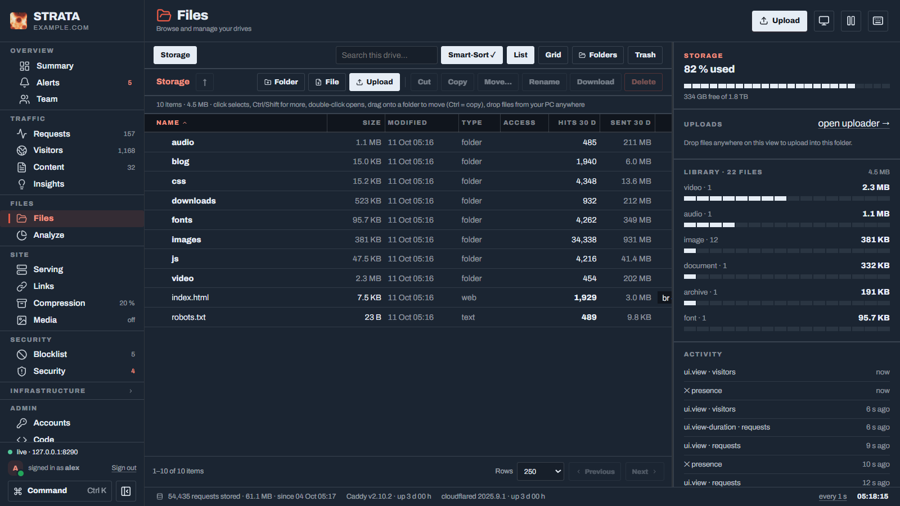

- **Files:** Browse, upload, rename and move files. Uploads are chunked and resumable, with a default limit of 20 GB per file. Strata keeps file versions that can be restored later. Smart-Sort organizes uploads into folders by file type.
- **Accounts:** Three roles — owner, administrators and members — with per-permission and per-folder access controls, account expiration dates and IP allowlists. Sign-ins require a second factor: the owner uses an authenticator app, while other accounts receive codes by e-mail. Accounts with permissions beyond file management can only sign in from the local network. API keys and an audit log are also available.
- **Health:** Monitors Caddy, Cloudflare Tunnel edge connections, storage latency and host health every few seconds.
- **Source editor:** Edit Strata's own source code in the browser, with conflict detection and backups.
- **Image links** (`transform/`): Resize and convert images using URL parameters such as `?w=`, `?h=` and `?fm=`.
- **Media** (`media/`, disabled by default): Serve AVIF/WebP images and WebM/MP4 video, with `?nocompress` to request the original. Resource-intensive processing pauses when the CPU is busy. The pipeline can also scan new uploads before they become public. Image conversion is running on my own server; video conversion and upload scanning are newer and have seen less use. See [media/DESIGN.md](media/DESIGN.md).
- **Telemetry** (optional): Publish a statistics page using redacted numerical data.

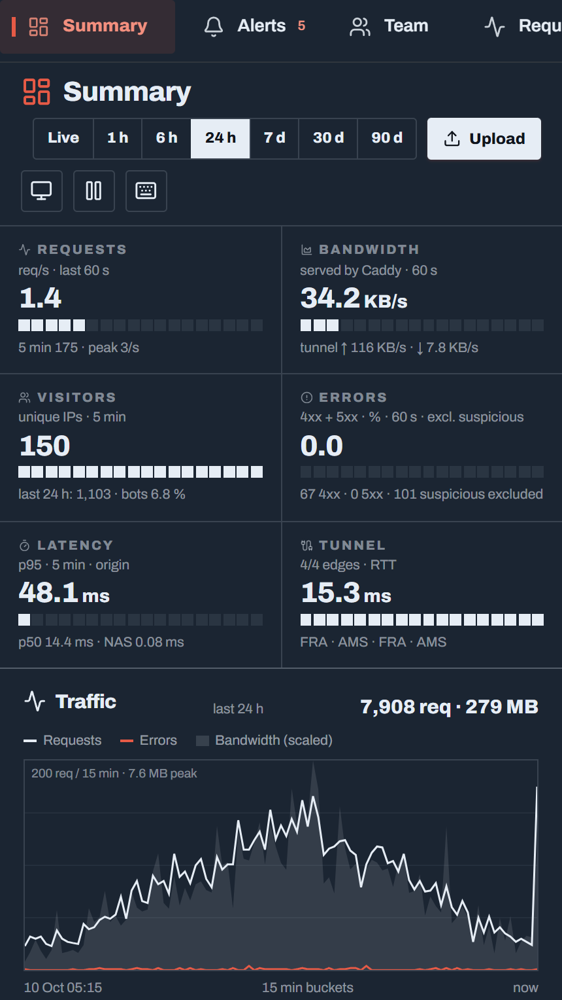

On mobile, the sidebar becomes a horizontally scrollable row of tabs, and dashboard tiles stack vertically.

A Team page with a directory, presence information and a noticeboard is present in the code but currently hidden.

## Install


### Windows

Install [Python 3.10 or newer](https://www.python.org/downloads/) from python.org. The Microsoft Store version cannot run Strata as a service.

Place the code in a directory such as `C:\Strata\`, open a terminal there and run:

```powershell
python setup.py
```

Alternatively, double-click `setup.cmd`. The installer requests administrator privileges to register the service and asks before making changes.

The installer proceeds through these steps:

1. **Python packages:** Installs `brotli`, `zstandard`, `Pillow` and `qrcode` into `vendor/` alongside the code. This lets the service find the packages regardless of which user it runs as.
2. **Site configuration:** Sets the domain, CDN hostname (`cdn.<domain>` by default) and directory to serve.
3. **Caddy:** Finds `caddy.exe` or offers to install it through winget. Backs up the existing Caddyfile in `backups/`, adds the import directive and optionally configures a LAN-accessible dashboard site. If Caddy rejects the updated configuration, the original file is restored.
4. **Cloudflare Tunnel:** Finds `cloudflared`, backs up its `config.yml` and adds an ingress rule for the CDN hostname. If no tunnel is configured, the installer can create one through Cloudflare's browser sign-in flow and point the DNS record to it.
5. **Credentials:** Optionally configures a Cloudflare API token and e-mail delivery, then creates the owner's account. The installer either displays a QR code for an authenticator app or asks for the owner's e-mail address.
6. **Configuration:** Writes `strata.json` to the instance directory and every secret to `data/.env` (see [Secrets](#secrets)). An existing `strata.json` is backed up first, without its secrets.
7. **Service:** Registers a Windows Task Scheduler task that starts Strata at boot as `SYSTEM` and restarts it after a failure.

After installation, open [http://127.0.0.1:8090](http://127.0.0.1:8090). If you skipped owner account creation, this address provides a one-time setup form that only works when accessed from the server itself.

You can run `setup.py` again at any time to change the configuration. Each prompt shows the current value; press Enter to keep it.

#### Installer options


| Command                                       | Purpose                                                                                    |
| --------------------------------------------- | ------------------------------------------------------------------------------------------ |
| `python setup.py --check`                     | Check what's installed and running without changing anything.                              |
| `python setup.py --no-service`                | Configure Strata without registering a service. Start it manually with `python strata.py`. |
| `python setup.py --home D:\sites\example.net` | Configure another instance in a separate directory, using the next available ports.        |
| `python setup.py --uninstall`                 | Remove the service without deleting configuration or data.                                 |


### Linux

Linux is a supported and tested platform. Install Caddy and `cloudflared` through their respective packages, then run the installer with `sudo`; the installer configures systemd.

To enable tunnel restarts from the dashboard, set `instance.tunnel_restart` to `{"kind": "service", "name": "cloudflared"}`. Strata will restart the configured `cloudflared` systemd service.

### E-mail and sign-in codes

Every sign-in requires a six-digit code after the password. The owner can use an authenticator app, which doesn't require e-mail configuration. Other accounts receive their codes by e-mail, so a single-user installation doesn't need mail delivery, but inviting other users does.

Strata supports any SMTP server or [Resend](https://resend.com). For Resend, you need an API key and a sender address on a verified domain. Configure delivery under **Security › Alerts › Delivery**.

When the owner has configured an authenticator app, sign-in uses that app instead of an e-mailed code. The **Trust this browser for 30 days** option on the authenticator-code page skips the code on that browser for 30 days; the password is still required. Changing the password or replacing the authenticator app invalidates the trust.

You can also configure authentication and mail delivery from the server's command line. Strata prompts for the SMTP password rather than accepting it as a command-line argument.

```text
python auth.py --totp
python auth.py --totp off
python auth.py --smtp <host> <port> <user> <from address>
python auth.py --resend <api key> <from address>
python auth.py --email <owner address>
```

These commands configure the owner's authenticator app, remove it, configure SMTP or Resend delivery, or change the owner's e-mail address.

Port 465 uses TLS; other SMTP ports use STARTTLS. For an unencrypted mail relay on your own network, select **None** as the delivery encryption mode. Strata won't send a password to that relay. Restart Strata after changing settings through the command line.

The owner can also configure the authenticator app under **Settings › Security**.

## How it works

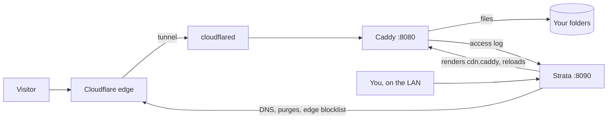


Strata manages the serving configuration and dashboard; Caddy handles visitor requests and serves the files. `cloudflared` connects Caddy to Cloudflare's edge.

The dashboard listens on `127.0.0.1` by default. Caddy can optionally expose it on your local network. Public visitors reach the serving site through the Cloudflare Tunnel, not the dashboard directly.

### Ports

| Port | Process                  | Purpose                                                                                        |
| ---- | ------------------------ | ---------------------------------------------------------------------------------------------- |
| 8090 | `strata.py`              | Dashboard and API, bound to loopback                                                           |
| 8091 | Caddy                    | Optional LAN-accessible dashboard                                                              |
| 8080 | Caddy                    | Serving site; the tunnel forwards traffic here                                                 |
| 8081 | `strata.py`              | Redacted telemetry feed, bound to loopback and protected by a token                            |
| 8083 | `transform/transform.py` | Image resizing and signed links, bound to loopback                                             |
| 8084 | `media/media.py`         | Media processing and delivery, when enabled                                                    |
| 8085 | `gate.py`                | Sign-in gateway for proxied services, bound to loopback                                        |
| 8923 | Anubis                   | Optional bot protection, started by its own start-up task, bound to loopback; metrics on 9923   |

A second instance configured with `--home` uses the same port layout offset by 100, starting at 8190, 8191 and so on.

## Configuration

Each instance has its own directory, referred to as the *instance directory*. By default, this is the code directory. It contains `strata.json`, the database in `data/` and the generated Caddy configuration in `generated/`.

A single copy of the code can run multiple instances, each started with its own `--home` argument. Most settings are managed through the dashboard. The installer writes the following configuration keys:

| Keys                                                                                                                             | Purpose                                                                                                 |
| -------------------------------------------------------------------------------------------------------------------------------- | ------------------------------------------------------------------------------------------------------- |
| `instance.name`, `instance.id`                                                                                                   | Dashboard name and a unique identifier for each instance                                                |
| `public.hosts`, `public_base_url`                                                                                                | Served hostnames and the base URL used for share links                                                  |
| `storage_paths`                                                                                                                  | Directories to serve; the first entry becomes the first drive                                           |
| `caddy_exe`, `caddyfile`, `access_log`                                                                                           | Caddy executable, configuration file and access log paths                                               |
| `cloudflared_exe`, `cloudflared_config`, `instance.tunnel_restart`                                                               | Tunnel executable, configuration file and tunnel restart behavior                                       |
| `cloudflare.zone_id`, `cloudflare.zone_name`                                                                                     | Cloudflare zone; the API token is `CF_API_TOKEN` in `data/.env`                                         |
| `alerts.provider`, `alerts.smtp`, `alerts.from`, `alerts.to`                                                                     | Mail provider, delivery settings, sender and recipient addresses; passwords and keys are in `data/.env` |
| `listen`, `feed_listen`, `transform_listen`, `gate_listen`                                                                       | Listen addresses for Strata's internal services                                                         |
| `anubis.enabled`, `anubis.bind`, `anubis.exe`, `anubis.difficulty`, `anubis.defaults`, `anubis.cookie_domain`, `anubis.metrics` | Optional bot protection (off by default); set from **Security › Challenger**                            |
| `anubis.public_url`                                                                                                              | `https://` (the default) or `http://` for a site not reached over TLS; only in `strata.json`            |


Defaults are defined in `DEFAULTS` near the top of [core.py](core.py). `strata.json` is excluded from version control through `.gitignore`, but it holds no secrets.

### Secrets

Every secret of an instance lives in `data/.env` in the instance directory: API keys and tokens, the SMTP password, webhook URLs, the owner's password hash, authenticator secret and recovery codes, and the cookie and link-signing keys. The variable names are listed in `SECRETS` in [instance.py](instance.py), for example `CF_API_TOKEN`, `STRATA_SMTP_PASSWORD` and `STRATA_SIGN_SECRET`.

- Strata writes the file atomically and restricts it to the account Strata runs as, SYSTEM and the Administrators group (mode `0600` on Linux). It does this again on every start, so a file you created by hand is locked down too.
- A secret found in `strata.json`, for example from an older version or a hand edit, moves to `data/.env` on the next start.
- The same variable set in the machine's own environment wins over `data/.env`. The dashboard can change what is in `data/.env`, but not what is set on the machine.
- Secrets never appear in `strata.json`, backups, logs, the JSON files Strata writes for its helper processes, or any dashboard response. The Code editor can't open `data/`.

Anyone with administrator rights on the machine can still read the file, so keep the machine itself secure.

## Platform support

Strata is tested and supported on both platforms. The differences below are platform-specific implementation details, not stability caveats.

| Feature                                             | Windows                       | Linux                                                                  |
| --------------------------------------------------- | ----------------------------- | ---------------------------------------------------------------------- |
| Dashboard, traffic, files, serving and accounts     | Supported                     | Supported                                                              |
| Installer                                           | Windows Task Scheduler        | systemd                                                                 |
| Restarting the tunnel from the dashboard            | Supported                     | Supported through the configured `cloudflared` systemd service         |
| Bot protection (Anubis)                             | Supported (Anubis 1.28.1)     | Supported (Anubis 1.28.1)                                              |
| Drive letters and volume labels in the drive picker | Supported                     | Not applicable                                                          |

## Development

Run the test suite with:

```bash
python tests/run_all.py
```

This creates a temporary Strata instance, uses a stub Caddy executable, seeds test accounts and runs the test suites. Coverage includes first-run setup, mail delivery, security regressions, permissions, the Team page, sign-in, the installer, automatic bans, bot protection and media unit tests. The bot protection suite sends real requests through a real Caddy when one is installed, and through a real Anubis as well when you set `STRATA_ANUBIS`.

The tests operate within the temporary directory. Caddy doesn't need to be installed, and the test run doesn't modify the rest of your system.

See [tests/README.txt](tests/README.txt) for details.

To start the demo instance:

```bash
python tests/demo.py
```

The demo runs at [http://127.0.0.1:8290](http://127.0.0.1:8290) and includes a week of synthetic traffic and sample files. The screenshots are taken from this instance. Its visitors use IP ranges reserved for documentation, so the demo doesn't display real visitor addresses.

### Code layout

```text
strata.py       HTTP server, routes and sign-in
core.py         Configuration, log tailing, metrics and database
accounts.py     Accounts, permissions and zones
auth.py         Passwords, sessions, TOTP and API keys
rollup.py       Aggregated statistics
alerts.py       Alerts, e-mail and webhooks
backup.py       Backup and restore
static/         Dashboard (vanilla JavaScript)

rules.py        Serving rules, Caddy configuration and automatic bans
files.py        File operations, uploads and versions
network.py      Cloudflare DNS, zone management and tunnel ingress
cloudflare.py   Cloudflare API, edge blocklist and cache purges
compress.py     Brotli precompression
gate.py         Sign-in gateway for proxied services
setup.py        Installer
media/          Media pipeline (see DESIGN.md)
```

Open work is tracked in [Issues](https://github.com/Sanedish/strata/issues).

## License

Strata is licensed under the [MIT License](LICENSE). You're free to change your copy, interface included. A published version that keeps the name **Strata** should keep its flat, plain design language; a generic "AI dashboard" restyle needs a name of its own. Details are in [CONTRIBUTING.md](CONTRIBUTING.md#forks-and-the-name-strata).

Contributions are welcome. Start with [CONTRIBUTING.md](CONTRIBUTING.md); `python tests/demo.py` runs the whole dashboard without Caddy or Cloudflare.

Optional bot protection uses [Anubis](https://github.com/TecharoHQ/anubis) by Techaro (MIT), which Strata can download for you from github.com when you ask (it isn't bundled); its licence is in [third_party/anubis/](third_party/anubis/LICENSE) and goes along with every download. The bundled CodeMirror 5.65.21 and Lucide icons retain their respective licenses in `static/vendor/`. Other dependencies are credited under **Settings › About**.

