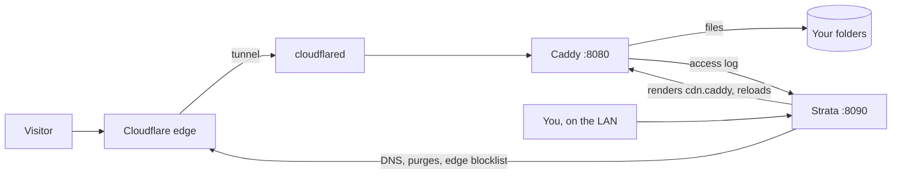

<h1 align="center">Strata</h1>

<p align="center">
<b>A self-hosted dashboard for running a Caddy file server behind a Cloudflare Tunnel.</b><br>
Drives and access rules, live traffic, auto-bans, alerts, accounts and file management,<br>
in plain Python with no web framework and no build step. It runs on your own machine.
</p>

<p align="center">


</p>

<p align="center">

</p>

<p align="center">
<a href="#install">Install</a> ·
<a href="#how-it-works">How it works</a> ·
<a href="#configuration">Configuration</a> ·
<a href="#development">Development</a> ·
<a href="SECURITY.md">Security</a>
</p>

---

I serve files from a NAS through Caddy and a Cloudflare Tunnel. Managing that meant editing the Caddyfile and the
cloudflared config by hand and reading Caddy's JSON access log to see what was going on. Strata started as a way to
stop doing that, and grew from there into what my own setup needs.

It runs on the same machine as [Caddy](https://caddyserver.com) and
[cloudflared](https://github.com/cloudflare/cloudflared). It reads Caddy's access log, writes the Caddy config for
the folders you serve, and can use the Cloudflare API for DNS, cache purges and blocking IPs at the edge. It is plain
Python with no web framework, stores everything in SQLite, and the dashboard is vanilla JavaScript with no build
step. It is built and used on Windows; on Linux the test suite passes, but no real install has run yet (see
[Platforms](#platforms)).

## What it does

### Serving files through Caddy

This is the part the rest is built around. You add *drives*: a folder, or a proxied service, on a hostname and an
optional URL prefix. Access rules attach to a drive or a path: block, allow, password, signed links, cache headers,
gallery folders, a download prompt, redirects. Strata turns all of it into one Caddy config file
(`generated/cdn.caddy`), which your own Caddyfile imports with a single line.

Every change is checked with `caddy validate` before Caddy reloads it. If validation fails, the running config
stays as it was. Earlier configs are kept, and you can roll back to one from the dashboard.

Files that shrink by enough get a Brotli copy next to them, which Caddy then serves to browsers that accept it.

### Ready-made pages: errors, galleries and the audio player

Strata ships three kinds of visitor-facing pages that work as soon as you switch them on. Each one is a plain HTML
file you can restyle without touching Strata's code or rebuilding anything.

| Page | Switch it on | What visitors get | The file to edit |
|---|---|---|---|
| **Error pages** | Site › Serving › Site › Error pages | Your own page for 404 (missing or hidden files), 403 (blocked, or in the trash) and 502/503/504 (a proxied service is down) instead of Caddy's plain text | An HTML file on one of your drives, `/errors/<code>.html` by default |
| **Gallery** | An access rule with the action **Gallery view**, e.g. `/photos/*` | A thumbnail grid with sorting, three tile sizes and a full-screen viewer, instead of a 404 for the folder | `gallery/gallery.html` |
| **Audio player** | An access rule with the action **Audio player**, e.g. `/music/*` | A full-page player with the cover art, title, artist and a visualizer when a desktop browser opens an audio file | `player/player.html` |

**Error pages** are the easiest to change. Click **Edit** next to a code: the first time, Strata writes a small
starter page to the drive you picked and opens it in the dashboard's editor. Change the text and colours, save, and
use **Preview** to see it in a new tab. Error pages are never cached, so visitors see a change right away. Leave the
502 field empty to keep Caddy's plain text.

**Gallery and player** are Caddy templates. Colours, fonts and spacing are CSS variables at the top of each file
(`--bg`, `--accent` and friends in the gallery, `--ink`, `--red` and `--mono` in the player), so most restyling is
a few lines. Caddy reads both files on every request: save, reload the page, and the change is live.
- The gallery's thumbnails come from Strata's link modifiers (`?w=`, `&fm=`), so Cloudflare caches them. The folder
  listing itself is never cached at the edge, so new uploads show up straight away.
- The player looks for a `cover.jpg`, `folder.jpg` or similar next to the track. Tracks without one get a random
  picture from a placeholder folder set on the rule. Phones, `<audio>` embeds, link previews and `?dl=1` still get
  the plain file, and `?raw=1` always does.

### Traffic

<table>
<tr>
<td width="50%"></td>
<td width="50%"></td>
</tr>
</table>

Strata tails Caddy's access log into SQLite. You get a live request log with filters and saved views, visitors by
country, network and client, the most requested files, and latency percentiles. Single requests are kept for 30 days
and per-minute, hourly and daily totals for 400, both adjustable. Countries come from Cloudflare's `Cf-Ipcountry`
header, so there is no GeoIP database to keep updated.

### Security


Requests for things like `/.env` or `/wp-login.php` count as probes. An address that sends too many gets banned
automatically. When several addresses in one /24 get banned within a week, the whole range is banned, and repeat
offenders get longer bans. With a Cloudflare token the blocklist is also pushed to Cloudflare, so banned visitors
are turned away at the edge instead of reaching your machine first.

Alerts (bans, failed sign-ins, outages, low disk space, error spikes) show up in the dashboard and can go out by
e-mail (any SMTP server, or Resend) and to webhooks (Discord, Slack, ntfy, or plain JSON).

<br clear="right">

### Everything else


- **Files:** browse, upload (chunked and resumable, 20 GB per file by default), rename, move, keep versions and
  restore them. Smart-Sort files uploads into folders by type.
- **Accounts:** an owner, administrators and members with per-permission and per-folder access, end dates and IP
  allowlists. Every sign-in needs a code: from an authenticator app for the owner, by e-mail for everyone else. Accounts that can change more than
  files can only sign in from the local network. There are API keys and an audit log.
- **Health:** Caddy, the tunnel's edge connections, storage latency and the host, polled every few seconds.
- **Code:** an editor for Strata's own source in the browser, with conflict checks and backups.
- **Image links** (`transform/`): `?w=`, `?h=` and `?fm=` for resized or converted images.
- **Media** (`media/`, off by default): serves AVIF/WebP images and WebM or MP4 videos to clients that can use them,
  with `?nocompress` for the original, and pauses heavy work when the CPU is busy. It can also scan new uploads before
  they go public. I run the image part on my own server; video conversion and upload scanning are newer and have seen
  much less use. See [media/DESIGN.md](media/DESIGN.md).
- **Telemetry** (`telemetry/`, optional): a public statistics page fed with redacted numbers only.

<br clear="right">


On a phone the sidebar turns into a row of tabs you can scroll and the tiles stack.

A Team page (directory, presence, noticeboard) exists in the code but is hidden for now.

<br clear="right">

## Install

### Windows

You need [Python 3.10 or newer](https://www.python.org/downloads/) from python.org (the Microsoft Store version can't
run as a service). Put the code in a folder such as `C:\Strata`, then in that folder:

```powershell
python setup.py
```

Or double-click `setup.cmd`. It asks for administrator rights because it registers a service, and asks before each
change. In order:

1. **Python packages:** `brotli`, `zstandard`, `Pillow` and `qrcode`, installed into `vendor/` next to the code so
   the service finds them whichever user it runs as.
2. **Your site:** the domain, the CDN hostname (`cdn.<domain>` by default) and the folder to serve.
3. **Caddy:** finds `caddy.exe` or offers to install it with winget. Backs up your Caddyfile into `backups\`, adds
   the `import` line, and optionally a site that shows the dashboard on your LAN. If Caddy rejects the result, the old
   file is put back.
4. **Cloudflare Tunnel:** finds cloudflared, backs up its `config.yml` and adds an ingress rule for the CDN hostname.
   Without a tunnel it can create one (a browser opens to sign in to Cloudflare) and point the DNS record at it.
5. **Keys and the owner account:** a Cloudflare API token (optional), mail for the sign-in codes (optional), and the
   owner's username and password. Then it shows a QR code for an authenticator app, or asks for the owner's e-mail
   instead.
6. **`strata.json`**, written to the instance folder. An existing one is backed up first.
7. **The service:** a Task Scheduler task that starts at boot as SYSTEM and restarts after a failure.

Then open `http://127.0.0.1:8090`. If you skipped the owner account, that address shows a one-time form to create it,
which only works from the machine itself.

`setup.py` can be run again at any time: each question shows the current value and Enter keeps it.

| Command | |
|---|---|
| `python setup.py --check` | Show what is installed and running, change nothing |
| `python setup.py --no-service` | Configure only; start Strata yourself with `python strata.py` |
| `python setup.py --home D:\sites\example.net` | A second site in its own folder, on the next free ports |
| `python setup.py --uninstall` | Remove the service. Configuration and data stay |

### Linux

The installer has a systemd path; run it with `sudo` after installing Caddy and cloudflared from their packages. It
has not been run on a real Linux machine yet, so expect problems, and reports are welcome. Restarting the tunnel from
the dashboard only works on Windows for now.

### Mail for sign-in codes

Every sign-in asks for a six-digit code after the password. The owner can take it from an authenticator app, which
needs no mail setup at all. Every other account gets its code by e-mail, so a site only you sign in to needs no
e-mail, but inviting people does. Mail goes out through any SMTP server (your mail provider's or your own), or a
[Resend](https://resend.com) API key with a sender on a domain you verified there. Switch between the two under
Security › Alerts › Delivery.

When the owner has an authenticator app, sign-in skips the e-mailed code. **Trust this browser for 30 days** on the
app-code page skips the code too, on that browser only: the password is still needed, and a new password or a new
app ends the trust. To change any of this later, on the server (the SMTP password is asked for, never passed as an
argument):

```
python auth.py --totp                                     set up the owner's authenticator app
python auth.py --totp off                                 remove it
python auth.py --smtp <host> <port> <user> <from address> mail through an SMTP server
python auth.py --resend <api key> <from address>          mail through Resend
python auth.py --email <owner address>
```

Port 465 uses TLS, any other port STARTTLS. A relay on your own network without encryption can be set to "None" in
Delivery; Strata then won't send a password to it. Restart Strata after a change made on the command line. The owner
can also set up the app in Settings › Security.

## How it works



The dashboard listens on `127.0.0.1` only. Caddy can optionally expose it on your LAN. Visitors from the internet
only ever reach Caddy, through the tunnel.

| Port | Process | Purpose |
|---|---|---|
| 8090 | `strata.py` | Dashboard and API (loopback) |
| 8091 | Caddy | Optional: the dashboard on your LAN |
| 8080 | Caddy | The site Strata renders; cloudflared points here |
| 8081 | `strata.py` | Redacted feed for the telemetry page (loopback, token) |
| 8083 | `transform/transform.py` | Image resizing and signed links (loopback) |
| 8084 | `media/media.py` | Media, when enabled (loopback) |
| 8085 | `gate.py` | Sign-in in front of proxied services (loopback) |

A second site set up with `--home` uses the same ports plus 100 (8190, 8191, ...).

## Configuration

Each site has an *instance folder* (by default the code folder) with `strata.json`, the database in `data/` and the
rendered Caddy config in `generated/`. One copy of the code can run several sites, each started with its own
`--home`. Most settings are changed in the dashboard; these are the ones the installer writes:

| Key | Meaning |
|---|---|
| `instance.name`, `instance.id` | Shown in the dashboard; `id` keeps names unique between sites |
| `public.hosts`, `public_base_url` | The hostnames you serve and the base URL for share links |
| `storage_paths` | Folders to serve. The first one becomes the first drive |
| `caddy_exe`, `caddyfile`, `access_log` | Where Caddy, its config and its log are |
| `cloudflared_exe`, `cloudflared_config`, `instance.tunnel_restart` | The tunnel and how to restart it after ingress changes |
| `cloudflare.api_token`, `cloudflare.zone_id` | Optional. The `CF_API_TOKEN` environment variable overrides the token |
| `alerts.provider`, `alerts.smtp` or `alerts.resend_api_key`, `alerts.from`, `alerts.to` | Mail for sign-in codes and alerts |
| `auth.totp_secret`, `auth.recovery` | The owner's authenticator app and recovery codes (hashed) |
| `listen`, `feed_listen`, `transform_listen`, `gate_listen` | Loopback addresses of Strata's own processes |

All defaults are in `DEFAULTS` at the top of [core.py](core.py). `strata.json` holds secrets and is in `.gitignore`.

## Platforms

| | Windows | Linux |
|---|---|---|
| Dashboard, traffic, files, serving, accounts | yes | test suite passes, no real install yet |
| Installer | Task Scheduler | systemd, untested |
| Restart the tunnel from the dashboard | yes | not yet |
| Drive letters and volume labels in the drive picker | yes | n/a |

## Development

```
python tests/run_all.py
```

Builds a throwaway instance in a temp folder with a stub Caddy, seeds some accounts and runs every suite: first-run
setup, mail, security regressions, permissions, team, sign-in, the installer, auto-bans and the media unit tests.
Nothing outside the temp folder is touched and Caddy doesn't have to be installed. More in
[tests/README.txt](tests/README.txt).

```
python tests/demo.py
```

Starts a demo on `http://127.0.0.1:8290` with a week of made-up traffic and sample files; the screenshots are from
it. Its visitors use the IP ranges reserved for documentation, so it never shows a real address.

```
strata.py         HTTP server, routes, sign-in             rules.py       serving rules, Caddy config, auto-ban
core.py           config, log tailer, metrics, database    files.py       file operations, uploads, versions
accounts.py       accounts, permissions, zones             network.py     Cloudflare DNS and zone, tunnel ingress
auth.py           passwords, sessions, TOTP, API keys      cloudflare.py  Cloudflare API, edge blocklist, purges
rollup.py         aggregated statistics                    compress.py    Brotli precompression
alerts.py         alerts, e-mail, webhooks                 gate.py        sign-in for proxied services
backup.py         backup and restore                       setup.py       the installer
static/           the dashboard (vanilla JS)               media/         media pipeline (see DESIGN.md)
```

What's next is in [ROADMAP.md](ROADMAP.md). The open items that matter most: one real run of the Linux path, one of
the Windows service as SYSTEM, and deciding whether sign-in should work without e-mail.

## License

[MIT](LICENSE). The bundled CodeMirror (5.65.21) and Lucide icons keep their own licenses, in `static/vendor/`. The
other projects Strata depends on are credited under Settings › About.
