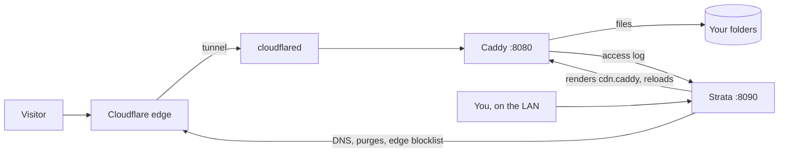

<h1 align="center">Strata</h1>

<p align="center">
A self-hosted control panel for a Caddy file server behind a Cloudflare Tunnel.<br>
Traffic analytics, file management, serving rules and security, on the machine that serves your files.
</p>

<p align="center">

</p>

<p align="center">
<a href="#install">Install</a> ·
<a href="#what-it-does">What it does</a> ·
<a href="#how-it-fits-together">How it fits together</a> ·
<a href="#configuration">Configuration</a> ·
<a href="#development">Development</a> ·
<a href="SECURITY.md">Security</a>
</p>

---

Strata runs next to [Caddy](https://caddyserver.com) and [cloudflared](https://github.com/cloudflare/cloudflared).
It reads Caddy's access log, writes the part of Caddy's config that serves your files, and talks to the Cloudflare API
for DNS, cache purges and edge blocking. You get one dashboard for what is being served, who is asking for it, and
what is trying to break in.

It is written in plain Python with no web framework and keeps everything in SQLite. It is built and used on Windows;
Linux support is written but not tested yet (see [Platforms](#platforms)).

## What it does

**Traffic.** A live request log with filters and saved views, visitors by country, network and client, the most
requested files, latency percentiles, and longer-term patterns. Individual requests are kept for 30 days and
aggregated statistics for 400 (both configurable), so the dashboard stays fast at millions of requests.

**Files.** Browse, upload (chunked and resumable, up to 20 GB per file by default), rename, move, version and restore
files on every drive you serve. Smart-Sorting files uploads into type folders. Disk usage and growth per folder.

**Serving.** Drives (folders or proxied services) on hostnames and URL prefixes, access rules (block, allow, password,
signed links, cache headers, gallery folders), custom 404 and 403 pages, short and signed links, and Brotli
precompression of every file that gets meaningfully smaller. Every change is validated by Caddy before it goes live, and older configs can be
restored from the history.

**Security.** Probe and scanner detection, auto-bans that widen to a /24 when a range keeps misbehaving and get longer
for repeat offenders, a blocklist that syncs to Cloudflare's edge, a login gate in front of proxied services, and
alerts by e-mail.

**Accounts.** An owner, administrators and members with fine-grained permissions, per-folder access zones, end dates,
IP allowlists, a code at every sign-in (from an authenticator app for the owner, by e-mail for everyone else), API
keys and an audit log. Accounts that can change more than files sign in only from the local network.

**Health.** Caddy, the tunnel connections, storage latency and the host itself, polled every few seconds.

<table>
<tr>
<td width="50%"></td>
<td width="50%"></td>
</tr>
<tr>
<td></td>
<td></td>
</tr>
</table>


The dashboard works on a phone too: the sidebar becomes a scrolling tab row and the tiles stack.

Strata also includes:

- **Team**: a directory, presence, a noticeboard and private notes for the people with accounts.
- **Code**: an in-browser editor for Strata's own source, with conflict checks and backups.
- **Strata Transform** (`transform/`): resizing and format conversion behind `?w=`, `?h=` and `?fm=` links.
- **Strata Media** (`media/`, off by default): AVIF and WebP variants negotiated per browser, a malware and content
  scan before files go public, and a circuit breaker that protects the CPU. See [media/DESIGN.md](media/DESIGN.md).
- **Strata Telemetry** (`telemetry/`): an optional public statistics page that only sees a redacted feed.

<br clear="right">

## Install

### Windows

You need [Python 3.10 or newer](https://www.python.org/downloads/) from python.org (the Microsoft Store version can't
run as a service). Put the code in a folder such as `C:\Strata` (clone it or unpack the zip), then in that folder:

```powershell
python setup.py
```

Or double-click `setup.cmd`. The installer asks for administrator rights because it registers a service, and asks
before every change. It walks through:

1. **Python packages.** Installs `brotli`, `zstandard`, `Pillow` and `qrcode` into `vendor/` next to the code, where
   the service finds them regardless of which user it runs as.
2. **Your site.** The domain, the CDN hostname (`cdn.<domain>` by default) and the folder to serve.
3. **Caddy.** Finds `caddy.exe` or offers to install it with winget. Backs up your Caddyfile into `backups\`, then adds
   one `import` line for the config Strata renders, and optionally a site that exposes the dashboard to your LAN.
   Caddy validates the result; if it doesn't, the old file is put back.
4. **Cloudflare Tunnel.** Finds cloudflared, backs up its `config.yml` and adds an ingress rule for the CDN hostname.
   With no tunnel yet it can create one (this opens a browser to sign in to Cloudflare) and point the DNS record at
   it.
5. **Keys and the owner account.** A Cloudflare API token (optional), a [Resend](https://resend.com) API key for
   e-mailed sign-in codes (optional), and the owner's username and password. Then it shows a QR code for an
   authenticator app, or asks for the owner's e-mail instead.
6. **`strata.json`**, written to the instance folder. An existing one is backed up first.
7. **The service.** A Task Scheduler task that starts at boot as SYSTEM, has no time limit and restarts after a
   failure. Then it waits for the dashboard to answer.

Open `http://127.0.0.1:8090` and sign in. If you skipped the owner account, the same address shows a one-time form
to create it; that form only works from the machine itself.

Running `setup.py` again is safe: every question shows the current value, and Enter keeps it.

| Command | |
|---|---|
| `python setup.py --check` | What is installed and running, without changing anything |
| `python setup.py --no-service` | Configure only; start Strata yourself with `python strata.py` |
| `python setup.py --home D:\sites\example.net` | Set up a second site in its own folder, on the next free ports |
| `python setup.py --uninstall` | Remove the service. Configuration and data stay |

### Linux

The installer does the same on Linux with systemd units instead of scheduled tasks; run it with `sudo`. Install
Caddy and cloudflared from their packages first. This path hasn't been tested on a Linux machine yet, so expect rough
edges, and reports are welcome. Restarting the tunnel from the dashboard is Windows-only for now.

### Sign-in codes

Every sign-in asks for a six-digit code after the password. The owner can take it from an authenticator app, which
needs no mail setup at all. Every other account gets its code by e-mail, sent through [Resend](https://resend.com)
from a sender address on a domain you verified there (the free tier is enough). So a site only you sign in to needs
no e-mail, but inviting people does.

When the owner has an authenticator app, sign-in skips the e-mailed code. To change either later, on the server:

```
python auth.py --totp                              set up the owner's authenticator app
python auth.py --totp off                          remove it
python auth.py --resend <api key> <from address>   e-mail for sign-in codes and alerts
python auth.py --email <owner address>
```

Restart Strata after a change made this way. The owner can also set up the app in Settings › Security.

## How it fits together



Nothing Strata runs is published to the internet: the dashboard listens on `127.0.0.1`, and Caddy can expose it to
your LAN. The public only ever reaches Caddy, through the tunnel.

| Port | Process | Purpose |
|---|---|---|
| 8090 | `strata.py` | Dashboard and API (loopback) |
| 8091 | Caddy | Optional: the dashboard for your LAN |
| 8080 | Caddy | The CDN site Strata renders; cloudflared points here |
| 8081 | `strata.py` | Redacted feed for Strata Telemetry (loopback, token) |
| 8083 | `transform/transform.py` | Resizing and signed links (loopback) |
| 8084 | `media/media.py` | Strata Media, when enabled (loopback) |
| 8085 | `gate.py` | Login in front of proxied services (loopback) |

A second site set up with `--home` gets the same set shifted by 100 (8190, 8191, ...).

## Configuration

Each site has an *instance folder* (by default the code folder itself) holding `strata.json`, the database in
`data/`, and the Caddy config Strata renders in `generated/`. One copy of the code can serve several sites, each
started with its own `--home`. Most settings are changed in the dashboard; these are the ones the installer writes:

| Key | Meaning |
|---|---|
| `instance.name`, `instance.id` | Shown in the dashboard; `id` keeps names unique between sites |
| `public.hosts`, `public_base_url` | The hostnames you serve and the URL that share links use |
| `storage_paths` | Folders to serve. The first one becomes the first drive |
| `caddy_exe`, `caddyfile`, `access_log` | Where Caddy, its config and the log it writes live |
| `cloudflared_exe`, `cloudflared_config`, `instance.tunnel_restart` | The tunnel and how to restart it after ingress changes |
| `cloudflare.api_token`, `cloudflare.zone_id` | Optional. The `CF_API_TOKEN` environment variable overrides the token |
| `alerts.resend_api_key`, `alerts.from`, `alerts.to` | E-mail for sign-in codes and alerts |
| `auth.totp_secret`, `auth.recovery` | The owner's authenticator app and recovery codes (hashed) |
| `listen`, `feed_listen`, `transform_listen`, `gate_listen` | Loopback addresses of Strata's own processes |

Every default is in `DEFAULTS` at the top of [core.py](core.py). `strata.json` holds secrets and is in `.gitignore`.

## Platforms

| | Windows | Linux |
|---|---|---|
| Dashboard, analytics, files, serving, accounts | yes | written, untested |
| Installer | Task Scheduler | systemd, untested |
| Restart the tunnel from the dashboard | yes | not yet |
| Drive letters and volume labels in the drive picker | yes | n/a |

## Development

```
python tests/run_all.py
```

Builds a throwaway instance in a temp folder with a stub Caddy, seeds a few accounts, and runs every suite: first-run
setup, security regressions, permissions, Team, sign-in, the installer, auto-bans and the Strata Media unit tests.
Nothing outside the temp folder is touched, and Caddy doesn't need to be installed. Details in
[tests/README.txt](tests/README.txt).

```
python tests/demo.py
```

Starts a demo on `http://127.0.0.1:8290` with a week of made-up traffic and sample files. The screenshots above come
from it. Its visitors use the IP ranges reserved for documentation, so it never shows a real address.

```
strata.py         HTTP server, routes, sign-in             rules.py       serving rules, Caddy config, auto-ban
core.py           config, log tailer, metrics, database    files.py       file operations, uploads, versions
accounts.py       accounts, permissions, zones             network.py     Cloudflare DNS and zone, tunnel ingress
auth.py           passwords, sessions, TOTP, API keys      cloudflare.py  Cloudflare API, edge blocklist, purges
rollup.py         aggregated statistics                    compress.py    Brotli precompression
alerts.py         alerts and e-mail                        gate.py        login gate for proxied services
setup.py          the installer                            static/        the dashboard (vanilla JS, no build step)
```

## Roadmap

[ROADMAP.md](ROADMAP.md) lists what is planned next: splitting up the Settings page, merging related pages into tabs,
custom CSS, backup and restore, and webhook alerts.

## License

[MIT](LICENSE). The bundled CodeMirror (5.65.21) and Lucide icons keep their own licenses, in `static/vendor/`.
